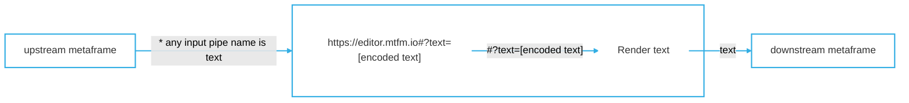

# Code/text editor [metaframe](https://docs.metapage.io/)


Metaframe (configurable website) for showing editing code or text. It embeds the [monaco code editor](https://microsoft.github.io/monaco-editor/) (core of [VSCode](https://code.visualstudio.com/)), so you can embed code display or full on editing easily and rapidly within metapages or your own websites, without having to install or configure modules.


The URL contains the entire (editable) text/code:


> 🔗 https://editor.mtfm.io#?text=**encoded-text**


This makes the URL

- **editable**
- **sharable**
- **embeddable**
- **standalone**

[Example standalone app with an editor and the markdown renderer](https://app.metapages.org/#?definition=JTdCJTIybWV0YSUyMiUzQSU3QiUyMmxheW91dHMlMjIlM0ElN0IlMjJyZWFjdC1ncmlkLWxheW91dCUyMiUzQSU3QiUyMmRvY3MlMjIlM0ElMjJodHRwcyUzQSUyRiUyRnd3dy5ucG1qcy5jb20lMkZwYWNrYWdlJTJGcmVhY3QtZ3JpZC1sYXlvdXQlMjIlMkMlMjJsYXlvdXQlMjIlM0ElNUIlN0IlMjJoJTIyJTNBNSUyQyUyMmklMjIlM0ElMjJlZGl0b3IlMjIlMkMlMjJtb3ZlZCUyMiUzQWZhbHNlJTJDJTIyc3RhdGljJTIyJTNBZmFsc2UlMkMlMjJ3JTIyJTNBNiUyQyUyMnglMjIlM0EwJTJDJTIyeSUyMiUzQTAlN0QlMkMlN0IlMjJoJTIyJTNBNSUyQyUyMmklMjIlM0ElMjJtYXJrZG93biUyMiUyQyUyMm1vdmVkJTIyJTNBZmFsc2UlMkMlMjJzdGF0aWMlMjIlM0FmYWxzZSUyQyUyMnclMjIlM0E2JTJDJTIyeCUyMiUzQTYlMkMlMjJ5JTIyJTNBMCU3RCU1RCUyQyUyMnByb3BzJTIyJTNBJTdCJTIyY29scyUyMiUzQTEyJTJDJTIyY29udGFpbmVyUGFkZGluZyUyMiUzQSU1QjUlMkM1JTVEJTJDJTIybWFyZ2luJTIyJTNBJTVCMTAlMkMyMCU1RCUyQyUyMnJvd0hlaWdodCUyMiUzQTEwMCU3RCU3RCU3RCU3RCUyQyUyMm1ldGFmcmFtZXMlMjIlM0ElN0IlMjJlZGl0b3IlMjIlM0ElN0IlMjJ1cmwlMjIlM0ElMjJodHRwcyUzQSUyRiUyRmVkaXRvci5tdGZtLmlvJTJGJTIzJTNGYnV0dG9uJTNEaW52aXNpYmxlJTI2bWVudWhpZGRlbiUzRHRydWUlMjZvcHRpb25zJTNESlRkQ0pUSXlZWFYwYjNObGJtUWxNaklsTTBGMGNuVmxKVEpESlRJeWFHbGtaVzFsYm5WcFptbG1jbUZ0WlNVeU1pVXpRWFJ5ZFdVbE1rTWxNakp0YjJSbEpUSXlKVE5CSlRJeWJXRnlhMlJ2ZDI0bE1qSWxNa01sTWpKellYWmxiRzloWkdsdWFHRnphQ1V5TWlVelFXWmhiSE5sSlRKREpUSXlkR2hsYldVbE1qSWxNMEVsTWpKc2FXZG9kQ1V5TWlVM1JBJTNEJTNEJTI2dGFiJTNEMSUyNnRleHQlM0RKVEl6SlRJd1RXRnlhMlJ2ZDI0bE1qQm9aV0ZrWlhJbE1FRWxNRUZVYUdsekpUSXdhWE1sTWpCdFlYSnJaRzkzYmlVeU1HTnZiblJsYm5RbE1FRWxNRUZCYm1RbE1qQnpiMjFsZEdocGJtY2xNakJsYkhObEpUSXdjMjl0WlElM0QlM0QlMjIlN0QlMkMlMjJtYXJrZG93biUyMiUzQSU3QiUyMmlucHV0cyUyMiUzQSU1QiU3QiUyMm1ldGFmcmFtZSUyMiUzQSUyMmVkaXRvciUyMiUyQyUyMnNvdXJjZSUyMiUzQSUyMnRleHQlMjIlMkMlMjJ0YXJnZXQlMjIlM0ElMjJtZCUyMiU3RCU1RCUyQyUyMnVybCUyMiUzQSUyMmh0dHBzJTNBJTJGJTJGbWFya2Rvd24ubXRmbS5pbyUyRiUyMyUzRmJ1dHRvbiUzRGludmlzaWJsZSUyNm1kJTNESlRJekpUSXdWR2hwY3lVeU1HbHpKVEl3ZVc5MWNpVXlNRzFoY210a2IzZHVKVEJCSlRCQlZHaGxKVEl3VlZKTUpUSXdZMjl1ZEdGcGJuTWxNakJoYkd3bE1qQjBhR1VsTWpCamIyNTBaVzUwJTI2bWVudWhpZGRlbiUzRHRydWUlMjZvcHRpb25zJTNESlRkQ0pUSXlaR2x6Y0d4aGVXMXZaR1VsTWpJbE0wRWxNakprWldaaGRXeDBKVEl5SlRkRSUyMiU3RCU3RCUyQyUyMnBsdWdpbnMlMjIlM0ElNUIlMjJodHRwcyUzQSUyRiUyRm1ldGFwYWdlcy5vcmclMkZtZXRhZnJhbWVzJTJGbWVybWFpZC5qcyUyRiUzRlRJVExFJTNEMCUyMiUyQyUyMmh0dHBzJTNBJTJGJTJGZWRpdG9yLm10Zm0uaW8lMkYlMjMlM0ZvcHRpb25zJTNEZXlKdGIyUmxJam9pYW5OdmJpSXNJbk5oZG1Wc2IyRmthVzVvWVhOb0lqcG1ZV3h6WlN3aWRHaGxiV1VpT2lKMmN5MWtZWEpySW4wJTNEJTIyJTVEJTJDJTIydmVyc2lvbiUyMiUzQSUyMjAuMyUyMiU3RA==)


## How to create / edit

Open the menu (the button in the top-right, or add `edit=true` to the URL), change
what you want in **Settings**, then use **Copy URL** in the header. The URL is the
document and its configuration together, so that one link is the whole thing.


## Embed in a metapage




- input pipes:
	- `text`
		- Raw markdown text
	- `*.json`
		- Any input field ending in `.json` will be JSON parsed first

## Embed code editor in another application


It requires no installation, and is secure due to cross-origin isolation.


### E.g. React


The help menu on this website uses this page in a external iframed element. While this uses `@metapages/metapage-embed-react` to make some things more convenient, you can also just embed a `<iframe src="<url>" />` element directly:


```typescript
import { MetaframeStandaloneComponent } from '@metapages/metapage-embed-react';

const encode = (s: string) => globalThis.btoa(encodeURIComponent(s));

// Editor config lives in the URL; the text itself flows over the input pipe.
const options = encode(JSON.stringify({ mode: "typescript" }));
const url = `https://editor.mtfm.io/#?options=${options}&hm=disabled`;

export const PanelCodeEditor: React.FC<{ code: string }> = ({ code }) => {

  const onOutputs = (outputs: { text?: string }) => {
    // do something with the edited text e.g. saving
    console.log(outputs.text);
  };

  return (
    <div>
      <MetaframeStandaloneComponent
        url={url}
        inputs={{ text: code }}
        onOutputs={onOutputs}
      />
    </div>
  );
};
```


## Developers: creating your own code editor links


You can generate your own code/text editor/display pages to display in your own webpages easily as embedded iframes.


The text is URI-encoded, then base64-encoded:


```typescript
export const encodeText = (text: string) => {
  return globalThis.btoa(encodeURIComponent(text));
};

const yourRawText = "Some code";
const encodedText = encodeText(yourRawText);
const url = `https://editor.mtfm.io/#?text=${encodedText}`
```

> ⚠️ Use `btoa(encodeURIComponent(text))`, **not** `btoa(text)`. The bare form throws on any
> character outside Latin-1 (accents, emoji, CJK) and silently corrupts any text containing a
> `%` — so `50% done` renders as an empty editor. The URI-encoding step is also correct for
> plain ASCII, so always use it.

## Saving

There is no Save button. An edit counts the moment it is made:

- it goes out on the **output pipe**, so whatever this frame is connected to sees it;
- and it is written into the **URL** as well, when `saveloadinhash` is set.

Nothing has to be pressed. The frame is usually embedded in someone else's page, where
nothing suggests a press is owed, and a button that must be found for work to be kept is a
way to lose work.

`autosend` used to opt in to this, back when the alternative was a Save button. It is still
accepted in a URL and ignored.

## Adding options to the code editor link

Currently supported options (all optional):
* `mode` - language id, defaults to `"json"`
* `theme` - `"light"` (default) or `"vs-dark"`
* `saveloadinhash` - boolean, persist edits back into the URL hash
* `readOnly` - boolean
* `wordWrap` - boolean, wrap long lines
* `hideLineNumbers` - boolean
* `autoFocus` - boolean, focus the editor on load
* `blockLocalEditorStateOverwrites` - boolean (keeps the local state of the editor from being clobbered after instantiation if new content is passed to the input)

Example:
```typescript
const yourOptions = {blockLocalEditorStateOverwrites: true, readOnly: true};
const encodedOptions = encodeText(JSON.stringify(yourOptions));
const url = `https://editor.mtfm.io/#?options=${encodedOptions}`
```

Just take that `url` and embed as described above, or via embedded as an iframe:


`<iframe src={url} />`

There is one more hash param, `editor`, which controls how reachable the menu is:
`editor=invisible` (default: the button is transparent until hovered, but always
clickable), `editor=visible`, or `editor=disabled` (no menu at all — use it for a
locked-down embed).

Its published name was `hm`, and `hm` is still read, forever: every URL already out
there uses it. Only `editor` is written.

## Settings

Everything in the Settings panel is a hash param, so a configured editor is just a URL.

| Setting | Hash param | Notes |
|---|---|---|
| Language | `options.mode` | Any Monaco language id, or a file extension such as `py`. Default `json`. |
| Read only | `options.readOnly` | Show the text without allowing edits. |
| Keep the text in the URL | `options.saveloadinhash` | The URL tracks the text as it is typed. Off means the URL keeps what it was opened with. |
| Wrap long lines | `options.wordWrap` | |
| Hide line numbers | `options.hideLineNumbers` | |
| Focus on load | `options.autoFocus` | Avoid on a page with several editors. |
| Protect local edits | `options.blockLocalEditorStateOverwrites` | Ignore incoming pipe values once something has been typed here. |
| Color scheme | `options.theme` | `light` (default), `vs-dark`, or `system`. Sets both the page and the editor's syntax colours. |
| Default background color | `bgColor` | A frame is transparent by default, so the page embedding it shows through. |
| Minimal header | `minimalheader` | |
| CSS URLs | `modules` | |

### Where Monaco comes from

This deployment serves Monaco from its own origin (`/vs/`), not from a public CDN.
The published app loaded it from `cdn.jsdelivr.net`, which means one CDN outage, or
one network that blocks public CDNs, and the editor never appears. Same version
(0.43.0), same language ids, no third party in the path.


## For AI agents and automated integration

See [llms.txt](https://editor.mtfm.io/llms.txt) for a short index, and
[llms-full.txt](https://editor.mtfm.io/llms-full.txt) for the complete machine-readable
integration reference: encoding in JavaScript and Python, every hash param and option with its
default, all supported language ids, and the known gotchas.

